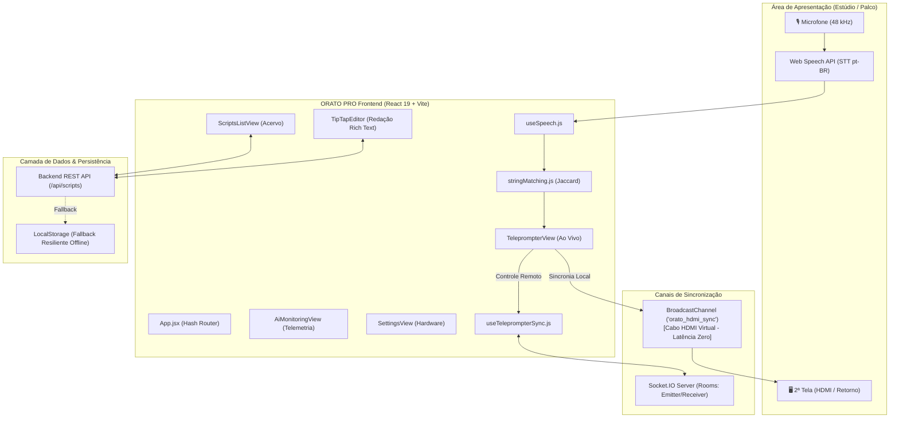

# ORATO PRO — Teleprompter Inteligente (MVP Rede Globo)

[](https://react.dev/)
[](https://vitejs.dev/)
[](https://tailwindcss.com/)
[](https://tiptap.dev/)
[](https://socket.io/)
[](https://vite-pwa-org.netlify.app/)

> Plataforma web de alta performance para teleprompter inteligente desenvolvida para ambientes de estúdio e transmissões ao vivo. O sistema integra reconhecimento contínuo de voz (Speech-to-Text), rastreamento dinâmico palavra por palavra com tolerância a improvisos, sincronização inter-telas com latência zero via Cabo HDMI Virtual (BroadcastChannel) e Socket.IO, editor de roteiros com TipTap e telemetria acústica em tempo real.

---

## 📌 Sumário

1. [Visão Geral & Escopo do MVP](#-visão-geral--escopo-do-mvp)
2. [Arquitetura do Sistema](#-arquitetura-do-sistema)
3. [Módulos & Funcionalidades Ativas](#-módulos--funcionalidades-ativas)
   - [01. Apresentação & Teleprompter STT](#01-apresentação--teleprompter-stt-apresentacao)
   - [02. Editor de Roteiros Profissional (TipTap)](#02-editor-de-roteiros-profissional-editor)
   - [03. Gestão e Acervo de Roteiros](#03-gestão-e-acervo-de-roteiros-roteiros)
   - [04. 2ª Tela / Saída HDMI de Palco](#04-2ª-tela--saída-hdmi-de-palco-segunda-tela)
   - [05. Telemetria & Monitoramento de IA](#05-telemetria--monitoramento-de-ia-monitoramento)
   - [06. Configurações de Estúdio & Hardware](#06-configurações-de-estúdio--hardware-configuracoes)
4. [Design System & Proporção Cromática (80 / 15 / 5)](#-design-system--proporção-cromática-80--15--5)
5. [Mecanismos de Sincronização & Inteligência](#-mecanismos-de-sincronização--inteligência)
6. [Atalhos Globais de Teclado](#-atalhos-globais-de-teclado)
7. [Estrutura de Diretórios](#-estrutura-de-diretórios)
8. [Instalação e Execução](#-instalação-e-execução)
9. [Variáveis de Ambiente](#-variáveis-de-ambiente)
10. [Requisitos e Compatibilidade](#-requisitos-e-compatibilidade)

---

## 🚀 Visão Geral & Escopo do MVP

O **ORATO PRO** foi concebido no âmbito da Residência Tecnológica Rede Globo & Senac para modernizar a operação de teleprompters em estúdios de jornalismo e entretenimento.

### Principais Dores Solucionadas:
- **Eliminação da dependência de pedais mecânicos e operadores manuais:** O texto avança organicamente acompanhando a locução real do apresentador via reconhecimento neural de voz.
- **Tratamento inteligente de improvisos e pausas:** Caso o orador saia do roteiro planejado, a rolagem pausa automaticamente sem travamentos bruscos e retoma assim que o discurso reencontra o texto original.
- **Transmissão multi-telas de baixíssima latência:** Controle da operação na bancada do operador com streaming em tempo real para monitores de retorno e espelhos ópticos (vidros 70/30).
- **Redação e pauta integradas:** Redação em tempo real com editor rich-text, estimativa de tempo de leitura e sincronização bidirecional.

---

## 🏛 Arquitetura do Sistema



---

## 📦 Módulos & Funcionalidades Ativas

### 01. Apresentação & Teleprompter STT (`#apresentacao`)
- **Acompanhamento por Voz (Speech-to-Text):** Integração nativa com a Web Speech API (`pt-BR`) em modo contínuo com normalização fonética NFD.
- **Rastreamento Palavra por Palavra (*Word-by-Word*):** Realce amarelo dinâmico da palavra atualmente pronunciada na frase.
- **Detecção de Improviso (Algoritmo de Similaridade Jaccard):**
  - Compara a transcrição em tempo real contra o bloco ativo (limiar de 30% de similaridade).
  - Em caso de desvio (`IMPROVISO`), a rolagem é suspensa suavemente sem piscar a tela e retoma automaticamente quando as palavras do roteiro voltam a ser detectadas.
- **Progressão Cadenciada por WPM:**
  - Ajuste de velocidade de 80 a 260 WPM (padrão de estúdio calibrado em 140 WPM).
  - Rolagem automática suave acionada por temporizador adaptativo ou rolagem livre.
- **Linha-Guia Focal dos Olhos ("Foco da Câmera"):**
  - Linha horizontal amarela fixa centralizada na tela com feixe focal e indicadores laterais para ancorar o contato visual direto com a lente.
- **Controles de Operação:** Play/Pause, avançar/retroceder blocos, reiniciar roteiro e simulação de teste de improviso.

### 02. Editor de Roteiros Profissional (`#editor`)
- **Motor TipTap / ProseMirror (`TipTapEditor.jsx`):**
  - Suporte completo a estruturas de bloco: Parágrafo, Título 1 (`H1`), Título 2 (`H2`) e Título 3 (`H3`).
  - Formatações de estilo inline: Negrito (`Ctrl+B`), Itálico (`Ctrl+I`) e Sublinhado (`Ctrl+U`).
  - Alinhamento tipográfico flexível: À Esquerda, Centralizado (ideal para palcos) e À Direita.
  - Barra de ferramentas flutuante (*sticky toolbar*) com efeito `backdrop-blur`.
- **Métricas Jornalísticas Automatizadas:**
  - Contador de palavras em tempo real.
  - Estimativa dinâmica de tempo de fala calculada sobre a média de 130 WPM.
- **Ação Direta:** Botão "Apresentar no Prompter" para transição imediata da redação para o ar.

### 03. Gestão e Acervo de Roteiros (`#roteiros`)
- **Painel de Produção:**
  - Card em destaque para o roteiro principal ativo em estúdio.
  - Busca instantânea e filtragem por título ou corpo do texto.
  - Ações de criação rápida, edição, exclusão e visualização de data/hora relativa.
- **Modal de Pré-visualização:** Leitor rápido para checagem de texto antes de entrar no ar.

### 04. 2ª Tela / Saída HDMI de Palco (`#segunda-tela`)
- **Cabo HDMI Virtual (`BroadcastChannel`):**
  - Transmissão local inter-janelas com latência imperceptível sem sobrecarregar a rede externa.
  - Abre em pop-up independente (`window.open` 1280x720) voltada para o 2º monitor de estúdio.
- **Modo Espelho Óptico ([RF06]):**
  - Inversão horizontal via CSS (`transform: scaleX(-1)`) para leitura em vidros de teleprompter semidirecionais (70/30).
- **Ajuste de Escala Display ([RF07]):**
  - Zoom de fonte rápido de 32px a 80px (padrão 48px).
- **Fundo Totalmente Escuro ([RF08]):** Preto absoluto (`#000000`) para contraste máximo e ausência de reflexos indesejados no estúdio.

### 05. Telemetria & Monitoramento de IA (`#monitoramento`)
- **Painel de Diagnósticos Acústicos:**
  - Medição de latência de reconhecimento do motor neural (10 ms - 14 ms).
  - Índice de precisão fonética (99.8%).
  - Medidor VU de nível de entrada de áudio em tempo real.
  - Log auditável de eventos de sincronização (taxa de amostragem, buffer, alinhamento).

### 06. Configurações de Estúdio & Hardware (`#configuracoes`)
- **Hardware de Áudio:** Configuração da interface de captura (ex.: Microfone Shure SM7B) e taxa de amostragem de driver (48 kHz Broadcast SYNC).
- **Identificação da Operação:** Nome do operador e identificação da cabine/estúdio.
- **Restauração de Fábrica:** Botão de reset rápido para padrões seguros de transmissão.

---

## 🎨 Design System & Proporção Cromática (80 / 15 / 5)

A interface adota uma disciplina cromática rigorosa voltada a cabines de controle e ambientes de baixa luminosidade:

| Proporção | Cor / Token | Função / Aplicação |
| :--- | :--- | :--- |
| **80%** | **Cinza Escuro Profundo** (`#0C0E14`, `#12151D`, `#151821`, bordas `#282E3E`) | Superfícies estruturais, cartões flutuantes, tipografia neutra (`#F8FAFC`, `#94A3B8`) e fundo de alto contraste. |
| **15%** | **Vermelho Transmissão** (`#EF4444`) | Identidade broadcast, botão e indicador `REC / AO VIVO`, acentos de status e ações secundárias. |
| **5%** | **Amarelo Atenção Crítica** (`#FACC15`) | Foco focal dos olhos, CTAs primários ("Apresentar", "Novo Roteiro"), métricas essenciais (WPM, Latência) e palavra ativa na leitura. |

---

## 🔄 Mecanismos de Sincronização & Inteligência

### 1. Cabo HDMI Virtual (`BroadcastChannel`)
Permite que o operador execute o painel administrativo na tela principal e espelhe o conteúdo instantaneamente em uma janela pop-up desacoplada (`window.open` com `#segunda-tela`). As mensagens trafegam diretamente na memória do navegador via canal `orato_hdmi_sync`:
```javascript
const channel = new BroadcastChannel("orato_hdmi_sync");
channel.postMessage({
  script,
  blocks,
  activeBlockIndex,
  activeWordIndex,
  isPlaying,
});
```

### 2. Sincronização Remota via Socket.IO
Estruturada em salas dinâmicas com segregação de papéis:
- `emitter`: Instância do painel de controle que emite comandos de reprodução, pausa e alteração de cadência.
- `receiver`: Instância do teleprompter que escuta e consome os eventos `teleprompter:command:received`.

### 3. Tolerância a Improvisos via Similaridade Jaccard
A função `detectReadingStatus` em `src/utils/stringMatching.js` calcula a interseção entre o vocabulário recente do locutor e o bloco ativo no roteiro:
$$\text{Similaridade} = \frac{|\text{Palavras Faladas} \cap \text{Palavras do Bloco}|}{|\text{Palavras Faladas}|}$$
Se a similaridade for inferior a `0.3`, o sistema classifica o estado como `IMPROVISO`, suspendendo o avanço mecânico e aguardando a retomada.

---

## ⌨️ Atalhos Globais de Teclado

O sistema conta com um mapa de atalhos operacionais acessíveis via teclado (pressione <kbd>Esc</kbd> para fechar modais):

| Tecla | Ação | Descrição |
| :---: | :--- | :--- |
| <kbd>Espaço</kbd> | **Play / Pause** | Inicia ou pausa a rolagem automática do teleprompter |
| <kbd>↑</kbd> / <kbd>↓</kbd> | **Ajuste Manual** | Desloca a rolagem suavemente para cima ou para baixo |
| <kbd>+</kbd> / <kbd>-</kbd> | **Velocidade WPM** | Aumenta ou reduz a cadência de leitura |
| <kbd>M</kbd> | **Microfone STT** | Alterna entre ligar e silenciar o reconhecimento de fala |
| <kbd>F</kbd> | **Tela Cheia** | Entra ou sai do modo imersivo em tela inteira |
| <kbd>2</kbd> | **2ª Tela / HDMI** | Dispara o pop-up da segunda tela espelhada |
| <kbd>E</kbd> | **Editor** | Redireciona para o Editor de Roteiro do texto ativo |
| <kbd>R</kbd> | **Acervo** | Retorna à biblioteca de roteiros |
| <kbd>Esc</kbd> | **Fechar / Voltar** | Fecha modais abertos, menus ou a janela da 2ª tela |

---

## 📂 Estrutura de Diretórios

```
teleprompter-redeglobo-mvp-frontend/
├── public/                     # Ativos estáticos e ícones SVG
├── src/
│   ├── assets/                 # Imagens e marcas do projeto
│   ├── components/             # Telas e componentes da interface
│   │   ├── TipTapEditor/       # Editor Rich Text modular
│   │   │   ├── index.js
│   │   │   ├── TipTapEditor.css
│   │   │   └── TipTapEditor.jsx
│   │   ├── AiMonitoringView.jsx     # Painel de Telemetria de IA
│   │   ├── Header.jsx               # Navbar global com timecode REC
│   │   ├── ScreenNavigatorModal.jsx # Galeria de módulos e especificações
│   │   ├── ScriptEditorView.jsx     # Interface de redação do roteiro
│   │   ├── ScriptsListView.jsx      # Acervo e gerenciador de roteiros
│   │   ├── SecondScreenModal.jsx    # 2ª tela com HDMI virtual e modo espelho
│   │   ├── SettingsView.jsx         # Configurações de hardware e estúdio
│   │   ├── ShortcutsModal.jsx       # Modal informativo de atalhos
│   │   └── TeleprompterView.jsx     # Visor ao vivo com STT e guia visual
│   ├── hooks/                  # Hooks customizados de lógica e infraestrutura
│   │   ├── useSocket.js             # Conexão e ciclo de vida do Socket.IO
│   │   ├── useSpeech.js             # Web Speech API e higienização de texto
│   │   └── useTeleprompterSync.js   # Sincronização multi-telas via Socket
│   ├── services/               # Camada de comunicação com APIs
│   │   └── scriptsApi.js            # Integração REST com fallback em LocalStorage
│   ├── utils/                  # Utilitários puros
│   │   └── stringMatching.js        # Algoritmo Jaccard de detecção de improviso
│   ├── App.css                 # Estilos globais complementares
│   ├── App.jsx                 # Componente raiz, orquestração e hash routing
│   ├── index.css               # Diretivas do TailwindCSS e utilitários de espelho
│   └── main.jsx                # Ponto de entrada React 19
├── eslint.config.js            # Configuração do ESLint
├── package.json                # Dependências e scripts do projeto
├── postcss.config.js           # Processador PostCSS para Tailwind
├── tailwind.config.js          # Configuração de temas e extensões Tailwind
└── vite.config.js              # Configuração do Vite com suporte a PWA
```

---

## 🛠 Instalação e Execução

### Pré-requisitos
- **Node.js**: v18.0.0 ou superior (recomendado v20+)
- **NPM**: v9.0.0 ou superior
- **Navegador compatível**: Google Chrome ou Microsoft Edge (para suporte completo à Web Speech API nativa)

### Passo a Passo

1. **Clonar o repositório:**
   ```bash
   git clone <url-do-repositorio>
   cd teleprompter-redeglobo-mvp-frontend
   ```

2. **Instalar as dependências:**
   ```bash
   npm install
   ```

3. **Iniciar o servidor de desenvolvimento:**
   ```bash
   npm run dev
   ```
   A aplicação estará disponível em `http://localhost:5173`.

4. **Verificar a qualidade do código (Linting):**
   ```bash
   npm run lint
   ```

5. **Gerar o build de produção (com service worker PWA):**
   ```bash
   npm run build
   ```

6. **Testar o build localmente:**
   ```bash
   npm run preview
   ```

---

## ⚙️ Variáveis de Ambiente

Crie um arquivo `.env` na raiz do projeto para configurar a URL do backend:

```env
# URL base do servidor REST e WebSocket de Teleprompter
VITE_API_URL=http://localhost:3000
```

> **Nota de Resiliência:** Caso o backend não esteja ativo, o sistema utilizará automaticamente a camada de armazenamento local (`localStorage`), garantindo que a redação e a apresentação funcionem de forma 100% autônoma offline.

---

## 🌐 Requisitos e Compatibilidade

- **Reconhecimento de Voz:** A Web Speech API requer conexão com a internet no Google Chrome/Edge para acesso ao motor de fala em português (`pt-BR`). Conceda permissão de microfone ao navegador na primeira execução.
- **Saída de 2ª Tela:** Habilite a permissão de pop-ups no navegador para permitir que o botão "Abrir 2ª Tela" abra a janela externa sincronizada automaticamente no segundo monitor.
- **Instalação PWA:** O projeto gera manifest e service worker via `vite-plugin-pwa`, permitindo instalação como aplicativo desktop independente no Chrome e Edge.

---

<p align="center">
  <b>ORATO PRO</b> — Desenvolvido para o programa de Residência Tecnológica Rede Globo & Senac.
</p>
